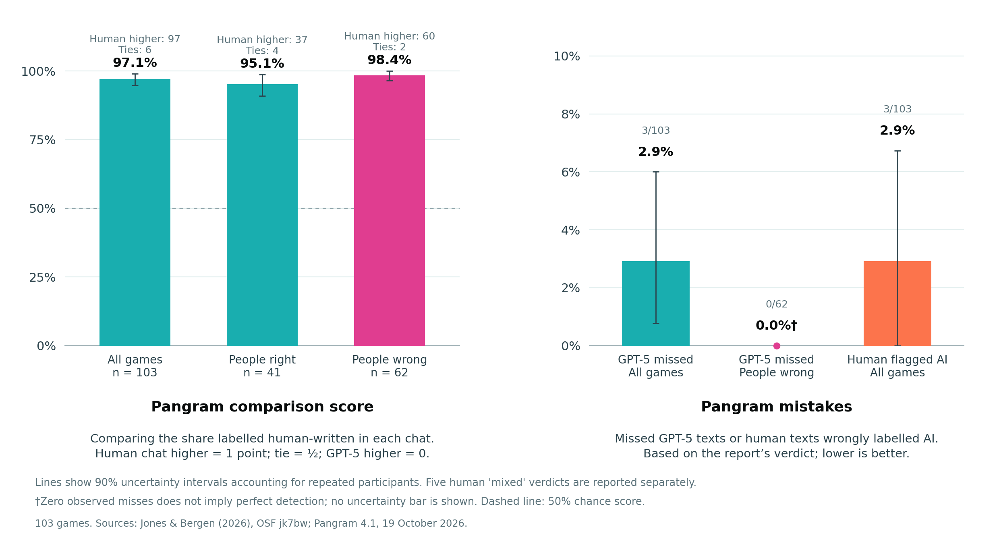

# AI detector was more accurate on GPT-5 chats that fooled people

I tested 103 matched pairs of human and GPT-5 chats using the AI detector
Pangram to see whether it made more mistakes on conversations people judged
correctly or those they got wrong. Pangram correctly flagged 100 of the 103
GPT-5 chats (97.1%), while incorrectly labelling three human chats as AI,
and another five as a mix of human and AI writing. It detected all 62 GPT-5
chats that fooled people, this is in comparison to 38 out of 41 (92.7%) in
games people judged correctly. Thus in this sample, Pangram performed better
on the chats that fooled people: all three AI chats it missed came from games
where people gave correct the answer.

Interestingly, all three GPT-5 chats that Pangram failed to detect as AI came
from games which people correctly detected as AI. However, it is important
to note that this pattern is based on a very limited number of mistakes with
only three missed AI texts by pangram. I also compared its performance in
cases where people correctly identified AI and games where they mistook it
for a human, rather than blindly treating the 100% figure as evidence that
people and detectors have different strengths and weaknesses in AI
identification.

## Learn more about this graph

The chart on the left compares Pangram’s ratings for the human and GPT-5
chats from each game. The reports provide an authorship breakdown showing
how much of the text Pangram thinks is human, AI, and AI-assisted. I treated
reports with only human writing as 100%, those with no human writing as 0%,
and mixed reports according to their displayed human/ai split. For mixed
reports, I used their displayed human percentage. I then awarded one point
when the actual human chat had the higher share, half a point when the two
shares were equal, and zero when GPT-5 had the higher share. The three bars
show the resulting score across all games, games in which people judged
correctly, and games they got wrong.

The right chart shows three error rates, missed GPT-5 texts across all games,
missed GPT-5 texts in games where people judged wrong, and human texts
incorrectly labelled as AI. I used each report’s verdict, counting only an
unambiguous AI verdict as successfully detecting GPT-5. A “Mixed” verdict
means the text is judged to contain both human and AI writing. None of the
GPT-5 texts received this verdict. Five human texts did; these are also
counted as incorrect classifications but are reported separately from the
three human texts labelled as entirely AI.

Pangram’s comparison score was higher in the cases that people got wrong
than on games they rated correctly as AI, however this difference is small
and would not be statistically significant in this sample. Pangram correctly
flagged all 62 GPT-5 texts that fooled people, as AI, but also flagged two of
the human texts as AI. In each of these two games Pangram labelled both the
human and GPT-5 text as AI, so it could not tell them apart. These games
therefore counted as ties in the left chart, while the GPT-5 texts still
counted as correctly detected in the right chart.

The data and analysis code are available
[here](https://github.com/Mseroczyn/Human_ai_detection_errors).

### Data

The data is publicly available through [OSF](https://osf.io/jk7bw/) from
[Jones and Bergen’s three-party Turing-test study (2026)](https://doi.org/10.1073/pnas.2524472123),
specifically their 15-minute replication with persona-prompted GPT-5. In each
game, a person talked with a human and AI witness before deciding which one
they thought was human.

The paper records 150 GPT-5 games, but the available data contains 148, with
GPT-5 selected as human in 87 of them. I excluded 45 games where either AI or
human witness produced fewer than 50 words as this is the lower limit for
Pangram. This left 103 matched games, 206 witness texts, half AI, half human,
containing 24,969 words.

For each witness, I combined their messages in their original order,
preserving the supplied wording and excluding the interrogator’s questions.
I scanned these texts using Pangram 4.1 on 19 October 2026.

### Analysis

For ordinary classification, I used Pangram’s verdict, counting only an
unambiguous AI verdict as successful detection. Mixed human-AI verdicts were
reported separately from AI only false positives in human text. Counting
Mixed as incorrect for either source gives 195 correct classifications out
of 206 (94.7%).

Pangram reports did not provide the continuous human/AI probability scores,
therefore, I compared the proportion of each text that Pangram labelled as
human written. Entirely human reports were treated as 100% human, entirely
AI reports as 0% human, and mixed reports retained their share of human
writing. A pair counted as correctly ordered when this share was higher for
the actual human, with equal shares counted as tie.

The table shows how Pangram compared the two chats in games people got right
and wrong. It ranked the human text higher in 97 games and tied the two in
six games; it never ranked GPT-5 higher. People got four of the six tied
games right.

| Human judgment | Human text ranked higher | Tied | GPT-5 text ranked higher |
|---|---:|---:|---:|
| Correct | 37 | 4 | 0 |
| Incorrect | 60 | 2 | 0 |
| **Total** | **97** | **6** | **0** |

Giving ties half a point produced a paired score of 98.4% when people were
wrong and 95.1% when they were right. The difference of 3.27 percentage
points, with a 90% uncertainty interval from -0.04 to 7.32 points. This
interval includes zero, so this comparison does not establish a difference
beyond this sample. People chose correctly in four of the six tied games.

To account for repeated participants, I grouped games connected by a person
appearing in either role and resampled these 48 groups 10,000 times. The
graph shows the resulting 90% uncertainty intervals.

### Assumptions and limitations

One important limitation is that GPT-5 is no longer a frontier model.
Therefore, Pangram’s performance here does not tell us how well it would
identify conversations generated by the most capable models available now.
Ideally, I would repeat this comparison using newer models. However, this
requires both human and AI conversations alongside people’s judgments of the
same pairs, which this freely available dataset provides. A more capable
model would not necessarily be harder to identify as AI, so whether this
pattern holds for newer models would need to be tested.

The results also concern one GPT-5 persona and one version of Pangram.
Different prompts or detectors could produce different results. I also
excluded games where either witness produced fewer than 50 words, so these
findings do not cover the shorter conversations in the original dataset.

Only three GPT-5 texts went undetected, so the finding that all three came
from games people judged correctly could change with a larger sample.
Similarly, detecting all 62 texts that fooled people does not mean Pangram
would detect every such text. Since the resampling only reuses the observed
games, it cannot show how uncertain that zero-miss rate is. This is why the
graph has no uncertainty bar for that point.

People and Pangram also assessed the conversations under different
conditions. People participated in the conversations and could ask
questions, while Pangram received only the completed witness messages.
So the disagreements show where their judgments differed, but do not explain
which features either used or whether detector advice would help people make
better decisions.

Finally, I adapted the comparison score after inspecting an initial batch
of reports, so this was an exploratory analysis rather than a test of a
fully specified prediction. The conversations were also publicly available
before I scanned them. It is therefore possible that Pangram encountered
them during training, although I do not know whether this happened.
